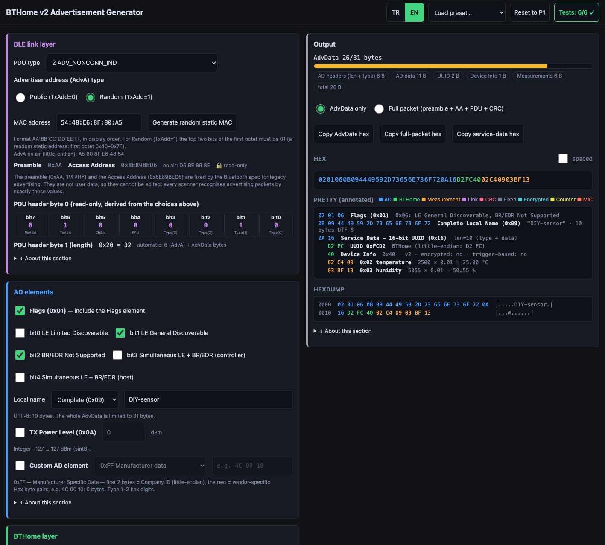

# BTHome Lab

Educational **BTHome v2** BLE advertisement **generator & decoder** that runs entirely in your browser.

**▶ Live demo:** <https://uretgec.github.io/bthome-lab/>

Build a complete Bluetooth Low Energy advertising packet step by step and watch
every byte change as you type — or paste any captured hex and decode it back:

```text
generate: link layer → AD elements → BTHome v2 service data → measurements → AES-CCM → CRC-24
decode:   hex → auto-detect format → annotated layers → AES-CCM decrypt → measurements
```



## Features

- Full packet anatomy: PDU header, public/random MAC, Flags, Local Name, TX power, custom AD
- Every BTHome v2 object (sensors, binary, events, text/raw, firmware) with live byte breakdown
- AES-CCM encryption with nonce visualization, verified against bthome.io test vectors
- **Decoder tab**: paste hex → auto-detects full packet / PDU / AdvData / service data / raw payload, with CRC check and MIC-gated decryption (wrong key or tampering → no plaintext shown)
- One-click roundtrip between generator and decoder — the tool verifies itself
- Hex · annotated pretty-print · hexdump outputs with byte-change highlighting
- 31-byte budget meter · TR/EN interface · 10 built-in self-tests
- Zero dependencies · 4 files · works offline — just open `index.html`

> This is a generator/decoder/learning tool. Browsers cannot transmit BLE advertisements.

## Specs

[BTHome format](https://bthome.io/format/) ·
[BTHome encryption](https://bthome.io/encryption/) ·
[Bluetooth Assigned Numbers](https://www.bluetooth.com/specifications/assigned-numbers/) ·
[RFC 3610](https://datatracker.ietf.org/doc/html/rfc3610)

---

## Türkçe

Tamamen tarayıcıda çalışan, eğitim amaçlı **BTHome v2** BLE reklam paketi **üreticisi ve çözücüsü**.

**▶ Canlı demo:** <https://uretgec.github.io/bthome-lab/>

Bir BLE reklam paketini adım adım kurun; siz yazdıkça her baytın değişimini canlı izleyin — ya da yakaladığınız hex'i yapıştırıp geri çözün:

```text
üret: link katmanı → AD yapıları → BTHome v2 service data → ölçümler → AES-CCM → CRC-24
çöz:  hex → otomatik format algılama → açıklamalı katmanlar → AES-CCM çözme → ölçümler
```

### Özellikler

- Eksiksiz paket anatomisi: PDU başlığı, public/random MAC, Flags, Local Name, TX power, özel AD
- Tüm BTHome v2 objeleri (sensör, ikili, event, text/raw, firmware) canlı bayt dökümüyle
- Nonce görselleştirmeli AES-CCM şifreleme; bthome.io test vektörleriyle doğrulanmış
- **Çözücü sekmesi**: hex yapıştırın → tam paket / PDU / AdvData / service data / ham payload otomatik algılanır; CRC kontrolü ve MIC kapılı şifre çözme (yanlış anahtar veya tahrifat → plaintext asla gösterilmez)
- Üretici ve çözücü arasında tek tıkla gidiş-dönüş — araç kendi kendini doğrular
- Hex · açıklamalı pretty-print · hexdump çıktıları ve değişen bayt vurgusu
- 31 bayt bütçe göstergesi · TR/EN arayüz · 10 yerleşik self-test
- Sıfır bağımlılık · 4 dosya · çevrimdışı çalışır — `index.html`'i açmanız yeterli

> Bu bir üretici/çözücü/öğrenme aracıdır; tarayıcılar BLE reklamı yayınlayamaz.

MIT © [Uretgec](https://github.com/uretgec)
